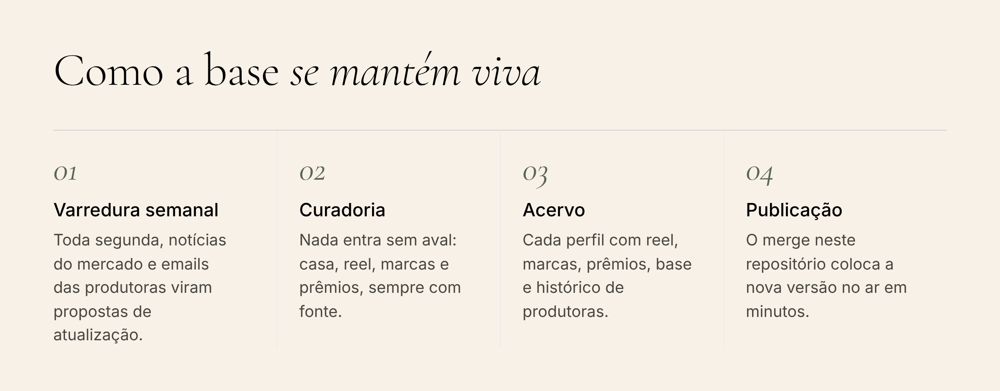

  

  <a href="https://ianinglez.com/oraculo/"><strong>Abrir o Oráculo</strong></a>

 

O **Oráculo de Diretores** é uma base curada de diretores de publicidade que trabalham no Brasil. Serve para responder à pergunta que abre todo job de produção: *quem dirigiria este filme?* Em vez de depender da memória de quem está na mesa, o produtor cola o roteiro e recebe uma lista comentada, com o motivo de cada indicação e o reel a um clique.

  

## Duas formas de usar

**Oráculo.** Cole o roteiro ou o briefing. O app lê tom, segmento, elenco, marca citada e até a verba (“R$ 800 mil”, “500k”) e organiza o resultado em faixas: os mais indicados, descobertas, nomes de fora do Brasil e o restante com afinidade. Cada card diz por que aquele nome apareceu (“Fez Becks, com humor e direção de atores”) e avisa quando o diretor costuma trabalhar acima da verba.

**Acervo.** Navegue pela base inteira com filtros de produtora, formato (individual, dupla, coletivo) e base (Brasil por cidade, exterior por país). A busca entende sinônimos: “cerveja” encontra quem tem histórico em bebidas.

Nas duas abas dá para marcar diretores com a estrela e copiar a shortlist pronta (nome, produtora e reel) para mandar à agência.

  

A base não é uma planilha congelada. Toda segunda uma varredura automática lê as notícias do mercado publicitário e os emails das produtoras, e transforma mudanças de casa, filmes novos e prêmios em propostas. Nenhuma delas entra sem conferência: perfil novo só vai ao ar com casa, reel e fonte confirmados.

## O que este repositório guarda

Este é o repositório **publicado**. Os dados e os scripts de curadoria ficam em um repositório separado; aqui chega só a versão compartilhável, já sem campos internos.

| Arquivo | Para que serve |
| --- | --- |
| `index.html` | O app inteiro em um arquivo só: interface, dados e busca. Não depende de servidor. |
| `worker.js` | Cloudflare Worker que serve o site em `ianinglez.com/oraculo`, bloqueia arquivos internos e pede aos buscadores para não indexar. |
| `wrangler.jsonc` | Configuração do Worker (rota, sem endereço público alternativo). |
| `assets/readme/` | Imagens deste README. Ficam fora do site publicado (`.assetsignore`). |

### Como publicar uma versão nova

1. No repositório de dados, gerar a versão compartilhada: `node scripts/publicar.js --com-niveis`.
2. Copiar `publicar/oraculo.html` para o `index.html` deste repositório, em uma branch.
3. Abrir o PR e fazer o merge. O Cloudflare publica sozinho a partir da `main`.

Para abrir localmente, basta o arquivo `index.html` no navegador, ou `python -m http.server` nesta pasta.

## Identidade

O visual segue um sistema próprio, pensado como um ateliê sob luz suave: tela creme `#f7f1e8`, texto carvão `#4a4741`, títulos em Cormorant Garamond com itálico, Inter no restante, cartões com linha de 1px e botões em pílula. Sem sombras e sem branco puro como fundo. As imagens deste README usam as mesmas regras e podem ser refeitas com `node assets/readme/source/render.js`.

## Sobre

Criado por **Ian Inglez**, produtor executivo, como ferramenta de curadoria para produção de publicidade.

Os dados vêm de fontes públicas e de estimativas feitas com apoio de IA, sempre revistas por curadoria humana. Antes de decidir, confira o reel e fale com a produtora.

Base de 25 de novembro de 2026: 546 diretores, 74 produtoras.

